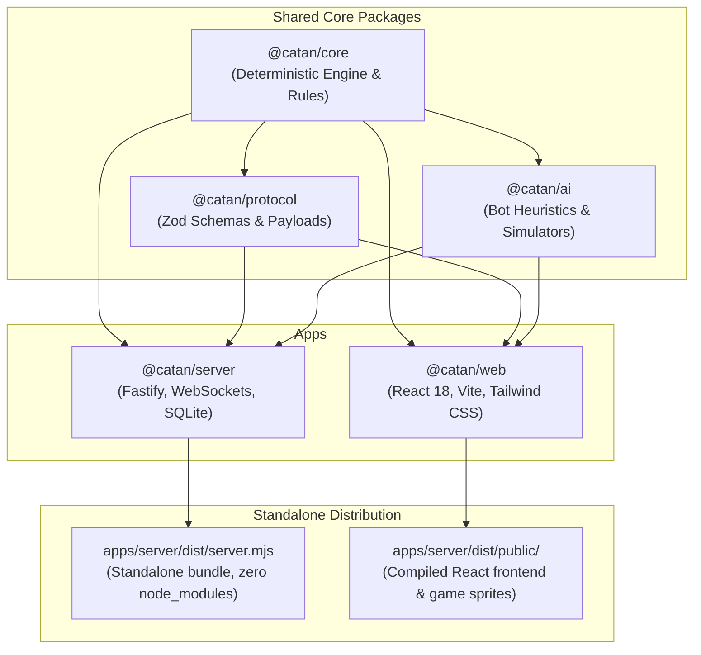
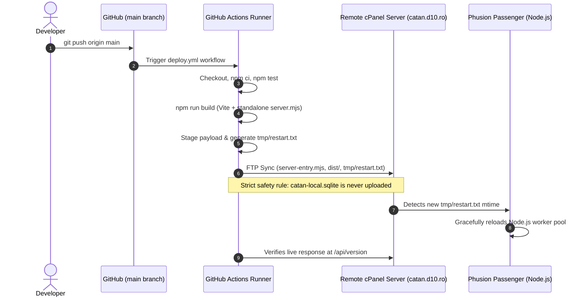

# Catan V2 — Comprehensive Developer & Architecture Guide

A modern full-stack web implementation of the Settlers of Catan board game with Seafarers expansion scenarios, deterministic game engine, multi-difficulty AI bot opponents, online multiplayer with real-time WebSocket synchronization, interactive replay & analysis, and responsive Tailwind CSS interface.

---

## 1. System Architecture Overview

The codebase is organized as an npm workspace monorepo divided into clean decoupled packages and applications:



### Directory Map

```text
catav-v2/
├── apps/
│   ├── server/                   # Fastify backend, WebSocket hub, SQLite database
│   │   ├── src/
│   │   │   ├── server.ts         # Fastify route registration & WebSocket server
│   │   │   ├── db.ts             # SQLite persistence (games, replays, users, ratings)
│   │   │   ├── cli-server.ts     # CLI entry point
│   │   │   └── cli-simulate.ts   # Bot benchmark CLI
│   │   ├── build-server.mjs      # esbuild standalone bundler script
│   │   └── server-entry.mjs      # Production entry point for Phusion Passenger
│   └── web/                      # React 18 client application
│       ├── src/
│       │   ├── components/       # Game assets, dialogs, surfaces, SVG board
│       │   │   ├── game/         # Game-specific dialogs (CostsHelp, DevCards, Trade, ScoreBank)
│       │   │   ├── ui/           # Reusable UI primitives (AdaptiveSurface, Dialog, AppNav, ThemeToggle)
│       │   │   ├── BoardSvg.tsx  # Dynamic interactive SVG board rendering
│       │   │   └── GameAssets.tsx# Reusable card sprites, badges, dice, and tokens
│       │   ├── hooks/            # Custom hooks (useTheme, useTradeState)
│       │   ├── styles/           # Tailwind CSS, tokens.css, and custom styles
│       │   ├── App.tsx           # Main application state and orchestration
│       │   ├── i18n.ts           # Romanian (ro) and English (en) localization
│       │   └── online.ts         # WebSocket client with automatic REST fallback
│       └── tailwind.config.js    # Tailwind configuration mapped to design tokens
├── packages/
│   ├── core/                     # Pure deterministic Catan game engine
│   │   └── src/
│   │       ├── board.ts          # Hex grid topology, vertices, edges, coordinate systems
│   │       ├── engine.ts         # State machine, action reducer, victory condition checks
│   │       ├── config.ts         # Scenario presets (Base, Seafarers, 5-6 player extensions)
│   │       ├── prng.ts           # Mersenne Twister seedable random number generator
│   │       ├── replay.ts         # Action log serialization and replay engine
│   │       └── types.ts          # Fundamental types (Resource, Building, Hex, DevCard, etc.)
│   ├── ai/                       # Bot decision engine and simulations
│   │   └── src/
│   │       ├── bot.ts            # Bot controller integrating difficulty levels
│   │       ├── evaluator.ts      # Strategic heuristics (settlement spots, robber placement, trades)
│   │       ├── simulator.ts      # Fast Monte Carlo rollout engine
│   │       ├── analysis.ts       # Post-game strategic analysis and win probability charts
│   │       └── llm-adapter.ts    # Optional LLM integration for conversational/strategic reasoning
│   └── protocol/                 # Shared communication schemas
│       └── src/
│           └── index.ts          # Zod validation schemas for all actions and events
├── tests/                        # Vitest test suites (core, ai, server, web)
├── scripts/                      # Build and version generation scripts
├── PROJECT_RULES.md              # Mandatory developer conventions & UI rules
├── DEPLOY.md                     # Remote deployment quick reference
└── package.json                  # Root workspace definition
```

---

## 2. Core Game Engine Architecture (`@catan/core`)

The engine is built on pure functional principles:
1. **Zero External Dependencies**: `@catan/core` runs in any JavaScript runtime (Node.js, browser, WebWorker, edge runtime).
2. **Deterministic Reducer Pattern**:
   Given an initial seed and a sequence of player actions:
   $$\text{State}_{t+1} = \text{reduceAction}(\text{State}_t, \text{Action})$$
   The state can be deterministically reconstructed from step 0 to step $N$.
3. **Hexagonal Coordinate System**:
   Board topology uses axial/cube coordinate conversions with vertices and edges indexed canonically to eliminate duplication and ambiguities when checking adjacent tiles, roads, and settlements.
4. **Replay Preservation**:
   Every game action is appended to an internal replay history log. Games can be rewound, stepped forward, or analyzed post-match with win probability curves.

---

## 3. Frontend Architecture & Tailwind CSS Theme System (`@catan/web`)

### Theming System
The interface uses Tailwind CSS configured with CSS design tokens defined in `apps/web/src/styles/tokens.css` and linked to `tailwind.config.js`.

Theme switching is controlled via `:root[data-theme="..."]`:
- **`dark` (Default)**: Deep navy `#0A1420`, dark slate surface `#192A3A`, gold accent `#B8863F`, parchment text `#EEF2F4`.
- **`light`**: Crisp background `#EEF1EC`, white surface `#FFFFFF`, sage accent `#2F6F5E`, dark ink text `#1C2620`.
- **`xmas`**: Festive forest green `#0F241A`, warm pine surface `#163B28`, holiday gold `#C9A24B`.

### Semantic Tailwind Color Classes:
- Backgrounds: `bg-bg`, `bg-surface`, `bg-surfaceMuted`
- Text: `text-ink`, `text-inkSoft`
- Borders: `border-line`
- Accents: `bg-accent`, `text-accentInk`, `border-accent`, `text-amber-500`
- Alerts: `text-warn`, `bg-warn`

---

## 4. Reusable UI Component Standards

All UI elements are organized into modular, reusable components:

### 1. Game Cards & Badges (`GameAssets.tsx`)
- **`ResourceCardSprite`**: Renders wood, brick, sheep, wheat, or ore card sprites with exact coordinate cropping from `/cards.jpg`.
- **`DevCardSprite`**: Renders development card faces (Knight, Road Building, Year of Plenty, Monopoly, Victory Point) or card back ("Catan").
- **`CostCardThumb`**: Reusable shortcut card for building costs with matching card dimensions (38×56px for `xs`), border, and label.
- **`CardBadge`**: Reusable count badge.
  - **Position**: Always in the **top-right corner** (`top: -6px; right: -6px;`).
  - **Muted style** when count is `0`.
  - **Gold highlight style** (`.has-items`) when count is `> 0`.
  - **Value**: Plain number `{count}` (e.g. `0`, `1`, `19`).
- **Cards Drawer Alignment**: In the bottom player dock (`.dock-cards-row`), all 7 cards share the exact same height and top baseline alignment.

### 2. Modals & Surfaces (`AdaptiveSurface.tsx`, `Dialog.tsx`)
- **`AdaptiveSurface`**:
  - Slide-over drawer on desktop screens (>960px).
  - Bottom sheet on mobile screens (<=960px).
  - **Close Trigger**: Clicking anywhere on the header bar or the mobile drag-handle dismisses the surface.
  - **Close Button**: High-contrast, tactile, prominent circular button with `aria-label="Close"`.
  - **`scrollable={false}` prop**: Enables fixed, non-scrollable modals for compact reference tables.
- **`Dialog`**: Centered blocking dialog for confirmations and discard decisions (z-index 60, stacks above surfaces).

### 3. Building Costs Reference (`CostsHelp.tsx`)
- Live rule-accurate reference table built from `BUILDING_COSTS`.
- **Single-Row Cost Layout**: All resource requirements for each building (Drum, Navă, Așezare, Oraș, Carte de Dezvoltare) are rendered on **one single horizontal row** (`flex-row flex-nowrap`) using compact `ResourceCostBadge` pills.
- Guaranteed to fit inside `AdaptiveSurface` without vertical scrolling.

---

## 5. Remote Server Architecture & Deployment Guide

### Remote Infrastructure
- **Production URL**: `https://catan.d10.ro`
- **Hosting Environment**: cPanel with **Phusion Passenger** (Node.js application manager).
- **Database**: SQLite embedded database (`catan-local.sqlite`) located in the application root directory alongside `server-entry.mjs`.
- **Network Resilience**: Full WebSocket bidirectional sync with automatic fallback to REST polling every 3 seconds if an intermediary firewall or Apache reverse proxy blocks WebSocket upgrade handshakes.

### Build Pipeline (`npm run build`)
Running `npm run build` executes a 5-step automated pipeline:
1. `clean-dist.mjs`: Cleans previous build artifacts.
2. `generate-version.mjs`: Inspects `git log` and generates `version.json` with commit count, hash, and changelog.
3. `vite build` (`@catan/web`): Compiles React + Tailwind CSS into `apps/web/dist`.
4. `build-server.mjs` (`@catan/server`): Bundles backend code and dependencies via esbuild into a **single standalone file** (`apps/server/dist/server.mjs`) and copies web assets into `apps/server/dist/public/`.
5. Re-generates `version.json` with final hash.

> **Zero Remote Dependencies**: The bundled `server.mjs` contains all code and packages (`ws`, `zod`, `@catan/core`, `@catan/ai`, `@catan/protocol`). **The remote server does NOT need `node_modules` at all.**

### CI/CD Deployment via GitHub Actions (Automated)

The project includes an automated deployment workflow defined in [`.github/workflows/deploy.yml`](.github/workflows/deploy.yml).



#### GitHub Secrets Configuration
To enable the automated deployment workflow, configure the following secrets in GitHub (**Repository Settings → Secrets and variables → Actions**):

| Secret Name | Required | Description | Example |
|---|---|---|---|
| `FTP_SERVER` | **Yes** | Remote FTP host / cPanel IP | `ftp.d10.ro` or `catan.d10.ro` |
| `FTP_USERNAME` | **Yes** | FTP account username | `catan@d10.ro` or cPanel username |
| `FTP_PASSWORD` | **Yes** | FTP account password | `YourSecretPassword` |
| `FTP_SERVER_DIR` | No | Target folder on server | `./` or `/public_html/` (default: `./`) |
| `FTP_PORT` | No | FTP port | `21` (default) |
| `FTP_PROTOCOL` | No | Protocol (`ftp` or `ftps`) | `ftp` (default) |

> **Automatic Passenger Reload**: The GitHub Action creates `tmp/restart.txt` with a fresh UTC timestamp during each deployment. Phusion Passenger detects this file and automatically reloads the application workers on the next request without needing manual intervention in cPanel!

### Manual Deployment Procedure (Local FTP Upload)

If you need to deploy manually from your development machine:

1. **Build locally**:
   ```bash
   npm run build
   ```

2. **Connect via FTP** to the cPanel hosting server and navigate to the application root directory.

3. **Upload the following files/directories (overwrite existing)**:
   | Local Source | Remote Destination |
   |---|---|
   | `apps/server/server-entry.mjs` | `server-entry.mjs` (in app root) |
   | `apps/server/dist/` (entire folder) | `dist/` (in app root) |

4. **CRITICAL WARNING — SQLite Database Safety**:
   > **DO NOT** upload `apps/server/catan-local.sqlite` to the server.
   > The live server's `catan-local.sqlite` holds live player accounts, high scores, and active online games. Overwriting it will destroy production data.

5. **Restart Node.js Application**:
   - Create or update `tmp/restart.txt` in the app directory, or:
   - Log into cPanel → **Setup Node.js App** → Select Application → **Restart**.
   - Go to **Setup Node.js App**.
   - Find the application and click **Restart**.

6. **Verify Deployment**:
   ```bash
   curl -s https://catan.d10.ro/api/version
   ```
   Check that `commitCount` and `shortHash` match your latest local commit (`git log -1 --format=%h`).

---

## 6. Local Development Commands

```bash
# Install all dependencies across all workspaces
npm install

# Run the test suite (Vitest)
npm test

# Build frontend and standalone server bundle
npm run build

# Start local server with hot reloading
npm --workspace=@catan/server run dev

# Start local web frontend with Vite dev server
npm --workspace=@catan/web run dev

# Or use the convenient Windows startup batch script
./start.bat
```
